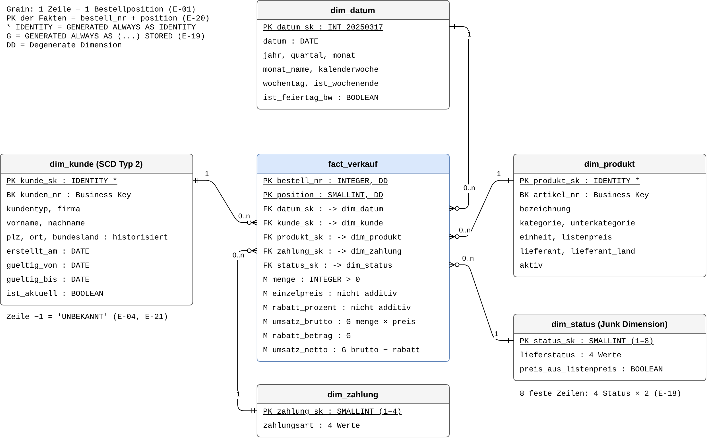

# DWH Süd-Mineralöl Handel GmbH

**Data Warehouse mit Python (pandas) und PostgreSQL 18 · Data warehouse with Python (pandas) and PostgreSQL 18**

Autor / Author: Daneesh Walika · Lizenz / License: [MIT](LICENSE)

[Deutsch](#deutsch) · [English](#english)



---

## Deutsch

### Ziel

Die Süd-Mineralöl Handel GmbH (fiktive Firma, synthetische Daten) exportiert ihre Daten aus dem
Warenwirtschaftssystem als CSV und JSON. Die Dateien sind uneinheitlich und enthalten Fehler: gemischte
Datumsformate, Dubletten, verlorene führende Nullen, unbekannte Kunden und Artikel, negative Mengen.

Das Projekt baut daraus mit **einem Befehl** (`python main.py`) ein geprüftes Data Warehouse im Star Schema auf.
Es beantwortet acht Business Questions (F-01 bis F-08), z. B. Umsatz je Monat, Top-10-Kunden, Umsatz je Kategorie
und Region **zum Zeitpunkt der Bestellung**, Stornoquote und Wiederholungskunden.

### Architektur

```
data/raw/  CSV + JSON (nie verändert)
     │
     ▼
pandas-ETL (etl/)
  01 Staging laden ─────────────► PostgreSQL 18, Schema stg   (1:1-Kopie, alle Spalten TEXT, Soll/Ist)
  02 dim_datum (Feiertage BW)
  03 Bereinigen + Prüfen ───────► abgewiesene Zeilen mit Grund
  04 Dimensionen (SCD 1 / SCD 2)
  05 Fakten + Gesamttest ───────► Schema dwh        (Star Schema)
                                  Schema protokoll  (abgewiesene Zeilen mit Grund)
     │                            → eine Transaktion: bei einem Fehler ROLLBACK
     ▼
SQL-Views (sql/05*) ────────────► Schema mart       (eine View je Business Question)
     │
     ▼
06 Diagramme D1–D3 (matplotlib) ► docs/diagramme/
main.py schreibt das Laufprotokoll ► logs/ (Laufzeit, Zeilen und md5 je Tabelle)
```

- **Star Schema:** Faktentabelle `fact_verkauf` (1 Zeile = 1 Bestellposition) mit fünf Dimensionen
  `dim_datum`, `dim_kunde`, `dim_produkt`, `dim_zahlung`, `dim_status`.
- **SCD Typ 2:** `dim_kunde` speichert Adressänderungen als neue Version (`gueltig_von`, `gueltig_bis`,
  `ist_aktuell`). So zeigt jede Bestellung den Wohnort zum Bestellzeitpunkt. Neue Update-Dateien
  `data/raw/kunden_update_JJJJ-MM-TT.csv` werden beim nächsten Lauf in Datumsreihenfolge übernommen.
  `dim_produkt` ist SCD Typ 1 (überschreiben).
- **Datenqualität:** Jede Bereinigungsregel ist dokumentiert (`docs/entscheidungen.md`). Abgewiesene Zeilen landen
  mit Grund in `protokoll.abgewiesene_position`. Kontrollzahlen (Soll/Ist) nach jedem Schritt; die Bilanz
  *Zeilen roh = geladen + abgewiesen + entfernte Dubletten* muss aufgehen, sonst Abbruch mit ROLLBACK.
- **Prüfsumme / Reproduzierbarkeit:** `main.py` berechnet eine md5-Prüfsumme je Tabelle. Ein zweiter Lauf mit
  denselben Dateien liefert dieselben Werte.

### Ordnerstruktur

```
main.py                 ein Befehl für alles
requirements.txt        Python-Pakete mit festen Versionen
db_config.example.ini   Vorlage für db_config.ini (Zugangsdaten, nicht in Git)
data/raw/               Rohdaten: bestellungen.csv, kunden.csv, kunden_update_2026-01.csv, produkte.json
scripts/                generate_data.py: erzeugt die synthetischen Rohdaten (Seed 42, byte-gleich)
etl/                    Ladestrecke 00–05, Diagramme 06, Regeln, Hilfsfunktionen
sql/                    DDL, Migrationen, mart-Views, Kontrollabfragen
tests/                  pytest-Tests (ohne Datenbank)
explore/                Datenexploration: erzeugt docs/data_quality_issues.*
docs/                   Steckbrief, Protokoll, Anforderungen, Entscheidungen (E-01 bis E-50), Ergebnisse,
                        Namenskonventionen, ERM, Star Schema (.drawio = Quelle, .png = Bild), Diagramme
```

Beim Lauf entstehen zusätzlich `logs/` und `data/rejected/` (nicht in Git).

### Voraussetzungen

- Python 3.12
- PostgreSQL 18 (lokal), z. B. mit pgAdmin 4 oder `psql`

### Installation

1. Python-Umgebung anlegen und Pakete installieren (im Projektordner):

   Windows:
   ```bash
   python -m venv .venv
   .venv\Scripts\python.exe -m pip install -r requirements.txt
   ```
   Linux / macOS:
   ```bash
   python3.12 -m venv .venv
   .venv/bin/python -m pip install -r requirements.txt
   ```

2. Leere Datenbank anlegen (einmalig). Mehr ist nicht nötig: Schemas, Tabellen und Views legt `main.py` selbst an.
   ```bash
   psql -U postgres -c "CREATE DATABASE dwh_sued;"
   ```
   (oder in pgAdmin: `CREATE DATABASE dwh_sued;`)

3. Zugangsdaten eintragen: `db_config.example.ini` nach `db_config.ini` kopieren und das Passwort eintragen.
   `db_config.ini` steht in `.gitignore`. Optional zeigt die Umgebungsvariable `DWH_DB_CONFIG` auf eine andere
   Konfigurationsdatei (z. B. für eine Test-Datenbank).

### Start

```bash
# Windows
.venv\Scripts\python.exe main.py
# Linux / macOS
.venv/bin/python main.py
```

`main.py` führt aus: 1. Datenbankobjekte anlegen, falls sie fehlen (es wird nichts gelöscht) → 2. Gesamtlauf
`etl/00_starte_gesamtlauf.py` mit 7 Schritten → 3. Nachlauf `sql/02d` → 4. Diagramme D1–D3 → Protokoll.

Die Konsole endet mit `Hauptlauf erfolgreich: 4 von 4 Schritten OK`. Erwarteter Tabellenstand:

| Tabelle | Zeilen | md5 |
|---|---|---|
| `dwh.dim_datum` | 2556 | `d5f0edc2743f54eef6ca57d6f96ade85` |
| `dwh.dim_zahlung` | 4 | `9af3eeecfd05675cb305215de3e3b805` |
| `dwh.dim_status` | 8 | `004c0487f61acbd0415ca6d1cc82bb27` |
| `dwh.dim_produkt` | 24 | `16336422e2a3636cad3355c0c1c06353` |
| `dwh.dim_kunde` | 173 | `b15450167d385370c7af259291e4b121` |
| `dwh.fact_verkauf` | 2081 | `aa087435ebc479d434310f8761da74f0` |
| `protokoll.abgewiesene_position` | 75 | `07bf289f8a75215a1e8a0d6b464fda1b` |

Abbruch-Test: `main.py --abbruch-test` lässt Schritt 5 absichtlich scheitern (ROLLBACK, Exit-Code 1);
ein normaler Lauf stellt danach den Stand wieder her.

### Tests

```bash
# Windows
.venv\Scripts\python.exe -m pytest tests
# Linux / macOS
.venv/bin/python -m pytest tests
```

Erwartet: `55 passed`. Die Tests brauchen keine Datenbank.

### Rohdaten neu erzeugen

```bash
python scripts/generate_data.py      # schreibt nach data/generated/, byte-gleich mit data/raw/
```

### Dokumente

| Dokument | Inhalt |
|---|---|
| [Steckbrief](docs/steckbrief.md) | Ziel, Leitfrage, Datenquelle, Datenmodell |
| [Anforderungen](docs/anforderungen.md) | Business Questions F-01 bis F-08, Qualitätsanforderungen Q-01 bis Q-05 |
| [Entscheidungen](docs/entscheidungen.md) | Decision Log E-01 bis E-50: Problem, Optionen, Entscheidung, Begründung, Folgen |
| [Protokoll](docs/protokoll.md) | Kontrollzahlen je Prüfung, Zeilenzahlen je Ladeschritt, Löschfristen |
| [Ergebnisse](docs/ergebnisse/ergebnisse.md) | Antworten auf F-01 bis F-08 mit Kontrollsumme |
| [Offene Fragen](docs/offene_fragen.md) | Fachliche Fragen und Annahmen bis zur Antwort |
| [Übersicht docs/](docs/README.md) | Alle Projektdokumente |

---

## English

### Goal

Süd-Mineralöl Handel GmbH (a fictional fuel and lubricant wholesaler, synthetic data) exports its data from its
ERP system as CSV and JSON. The files are inconsistent and contain errors: mixed date formats, duplicates, lost
leading zeros in postal codes, unknown customers and products, negative quantities.

With **one command** (`python main.py`) this project turns them into a validated data warehouse with a star schema.
It answers eight business questions (F-01 to F-08), e.g. revenue per month, top 10 customers, revenue by product
category and by region **at the time of the order**, cancellation rate and repeat customers.

### Architecture

```
data/raw/  CSV + JSON (never modified)
     │
     ▼
pandas ETL (etl/)
  01 load staging ──────────────► PostgreSQL 18, schema stg   (1:1 copy, all columns TEXT, expected vs. actual)
  02 dim_datum (public holidays)
  03 clean + validate ──────────► rejected rows with a reason
  04 dimensions (SCD 1 / SCD 2)
  05 facts + overall test ──────► schema dwh        (star schema)
                                  schema protokoll  (rejected rows with reason)
     │                            → one transaction: ROLLBACK on any failed check
     ▼
SQL views (sql/05*) ────────────► schema mart       (one view per business question)
     │
     ▼
06 charts D1–D3 (matplotlib) ───► docs/diagramme/
main.py writes the run log ─────► logs/ (runtime, row count and md5 per table)
```

- **Star schema:** fact table `fact_verkauf` (1 row = 1 order line) with five dimensions
  `dim_datum`, `dim_kunde`, `dim_produkt`, `dim_zahlung`, `dim_status`.
- **SCD Type 2:** `dim_kunde` stores address changes as new versions (`gueltig_von`, `gueltig_bis`, `ist_aktuell`),
  so every order shows where the customer lived at the time of the order. New delta files
  `data/raw/kunden_update_YYYY-MM-DD.csv` are applied in date order on the next run. `dim_produkt` is SCD Type 1.
- **Data quality:** every cleaning rule is documented (`docs/entscheidungen.md`). Rejected rows are written with
  a reason to the table `protokoll.abgewiesene_position`. Control totals (expected vs. actual) after every step;
  the balance *raw rows = loaded + rejected + removed duplicates* must hold, otherwise the run aborts with ROLLBACK.
- **Checksum / reproducibility:** `main.py` computes an md5 checksum per table. A second run on the same files
  produces identical checksums.

### Folder structure

```
main.py                 one command for everything
requirements.txt        pinned Python packages
db_config.example.ini   template for db_config.ini (credentials, not in Git)
data/raw/               raw data: bestellungen.csv, kunden.csv, kunden_update_2026-01.csv, produkte.json
scripts/                generate_data.py: generates the synthetic raw data (seed 42, byte-identical)
etl/                    load pipeline 00–05, charts 06, rules, helpers
sql/                    DDL, migrations, mart views, control queries
tests/                  pytest tests (no database needed)
explore/                data exploration: produces docs/data_quality_issues.*
docs/                   project brief, run log, requirements, decision log (E-01 to E-50), results,
                        naming conventions, ERD, star schema (.drawio = source, .png = image), charts
```

A run also creates `logs/` and `data/rejected/` (not in Git). Documentation and code comments are in German.

### Prerequisites

- Python 3.12
- PostgreSQL 18 (local), e.g. with pgAdmin 4 or `psql`

### Setup

1. Create a virtual environment and install the packages (in the project folder):

   Windows:
   ```bash
   python -m venv .venv
   .venv\Scripts\python.exe -m pip install -r requirements.txt
   ```
   Linux / macOS:
   ```bash
   python3.12 -m venv .venv
   .venv/bin/python -m pip install -r requirements.txt
   ```

2. Create an empty database (once). Nothing else is needed: `main.py` creates schemas, tables and views itself.
   ```bash
   psql -U postgres -c "CREATE DATABASE dwh_sued;"
   ```

3. Credentials: copy `db_config.example.ini` to `db_config.ini` and enter your password.
   `db_config.ini` is listed in `.gitignore`. Optionally, the environment variable `DWH_DB_CONFIG` points to a
   different config file (e.g. for a test database).

### Run

```bash
# Windows
.venv\Scripts\python.exe main.py
# Linux / macOS
.venv/bin/python main.py
```

`main.py` runs: 1. create database objects if missing (nothing is dropped) → 2. full pipeline
`etl/00_starte_gesamtlauf.py` (7 steps) → 3. post-load migration `sql/02d` → 4. charts D1–D3 → run log.

The console ends with `Hauptlauf erfolgreich: 4 von 4 Schritten OK`; the expected row counts and md5 checksums
are listed in the German section above. `main.py --abbruch-test` makes step 5 fail on purpose (ROLLBACK, exit
code 1); a normal run restores the state afterwards.

### Tests

```bash
# Windows
.venv\Scripts\python.exe -m pytest tests
# Linux / macOS
.venv/bin/python -m pytest tests
```

Expected: `55 passed`. The tests do not need a database.

### Regenerate the raw data

```bash
python scripts/generate_data.py      # writes to data/generated/, byte-identical to data/raw/
```

## License

[MIT](LICENSE) © 2026 Daneesh Walika
