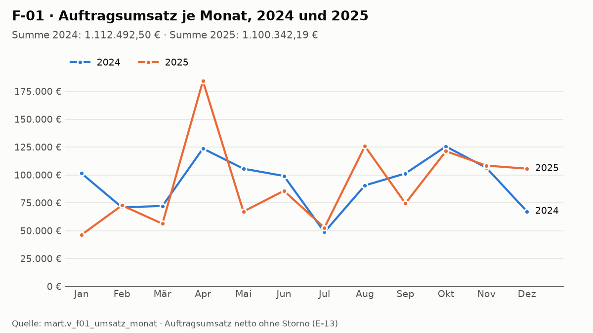
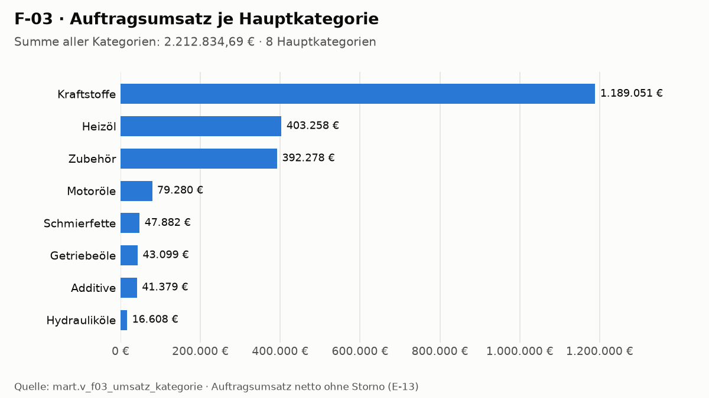
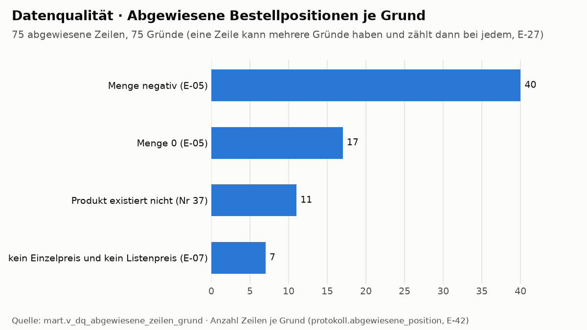

# Protokoll des Laufs · DWH Süd-Mineralöl

Stand: 19.10.2026 · Lauf `python main.py` am 19.10.2026 11:00:59 auf `dwh_sued`: 4 von 4 Schritten OK (5,5 s), Gesamtlauf 7 von 7
Quellen: `logs/hauptlauf.csv`, `logs/hauptlauf_tabellen.csv`, `logs/ladeprotokoll_staging.csv`, `logs/ladeprotokoll_dwh.csv`,
`logs/bereinigungsprotokoll.csv`, `logs/bereinigung_aenderungen.csv`, `logs/gesamttest_2026-10-19.csv`, `logs/diagramme.csv`.
Der Ordner `logs/` steht nicht in Git: Jeder Lauf von `main.py` erzeugt ihn neu.

## 1. Kontrollzahlen je Prüfung (vor dem Laden, korrigiert per Regel)

| Prüfung | Regel | Kontrollzahl | Reaktion |
|---|---|---|---|
| Duplikate | exakte Dubletten entfernt (O-05, E-30) | Bestellungen 25 · Kunden 4 · Produkte 1 · Update 0 | gezählt, entfernt |
| Pflichtfeld Preis | fehlt → Listenpreis + Kennzeichen (E-07) | 49 | korrigiert |
| Pflichtfeld Preis | fehlt, kein Listenpreis (E-07) | 7 | abgewiesen |
| Pflichtfeld Lieferant | fehlt → 'Unbekannt' (E-23) | 3 | korrigiert |
| Referenz Kunde | unbekannte Kundennummer → Kunde −1 (E-04) | 75 | korrigiert |
| Referenz Produkt | Produkt existiert nicht (Nr 37) | 11 | abgewiesen |
| Wertebereich Menge | negativ / 0 (E-05) | 40 / 17 | abgewiesen |
| Wertebereich in `fact_verkauf` | Menge ≤ 0, Rabatt außerhalb 0–100, Preis < 0, Datum nach Export (C3–C6) | 0 / 0 / 0 / 0 | sonst Abbruch |
| Formate (Datum, PLZ, Dezimalkomma, Schreibweisen) | Soll/Ist der Bereinigung gegen `docs/data_quality_issues.md` | 0 Abweichungen | sonst Meldung |
| Hinweise | mögliche Near Duplicates (E-06) 20 · Bundesland passt nicht zur PLZ (E-09) 4 · ganz in Großbuchstaben (E-28) 6 · Bundesland über Ort (E-26) 2 | | Warnung |
| Q-01 Abstimmung | roh = Fakten + abgewiesen + Dubletten | 2181 = 2081 + 75 + 25 | sonst Abbruch |
| Q-02 Grund nie leer | CSV und `protokoll.abgewiesene_position` | 0 ohne Grund | sonst Abbruch |

Abgewiesene Zeilen: 75, je mit Grund in `protokoll.abgewiesene_position` und `data/rejected/bestellungen_rejected.csv` (E-42).
Prüfungen im Lauf: Gesamttest in `etl/05` 36 von 36, `sql/04_gesamttest.sql` 29 von 29, `sql/05b_kontrolle_mart.sql` 29 von 29,
Diagramme 11 von 11. Zweiter Lauf: alle md5 gleich (Q-05).

## 2. Zeilenzahlen je Ladeschritt

| Schritt | Ziel | Zeilen | md5 |
|---|---|---|---|
| 1 Staging (Soll aus der Datei = Ist) | `stg.bestellungen` / `kunden` / `kunden_update` / `produkte` | 2181 / 157 / 20 / 25 | – |
| 2 Datumsdimension | `dwh.dim_datum` | 2556 | `d5f0edc2…` |
| 3 Bereinigung | Bestellungen: 2181 roh − 25 Dubletten − 75 abgewiesen | 2081 | – |
| 4 Dimensionen | `dim_produkt` / `dim_kunde` (153 Stamm + 14 neue Versionen + 5 neue Kunden + Zeile −1) | 24 / 173 | `16336422…` / `b1545016…` |
| 5 Fakten + Protokoll | `fact_verkauf` / `protokoll.abgewiesene_position` | 2081 / 75 | `aa087435…` / `07bf289f…` |
| 6–7 Kontrollen, Diagramme | `mart`-Views, `docs/diagramme/` | 3 Diagramme | – |

## 3. Diagramme

| D1 Umsatz je Monat (F-01) | D2 Umsatz je Hauptkategorie (F-03) | D3 Abgewiesene Zeilen je Grund |
|---|---|---|
|  |  |  |

## 4. Was würde passieren, wenn die Quelle morgen doppelt so groß wäre?

**Gemessen heute:** `data/raw/` 168 114 Byte; Datenbank 10 MB (davon `dwh` 992 kB, `stg` 408 kB, `protokoll` 64 kB).
Gesamtlauf 4,1–4,3 s in 12 normalen Läufen am 19.10.2026 (8 auf `dwh_sued`, 4 auf leeren Test-Datenbanken), `main.py` gesamt 5,5 s (`logs/hauptlauf.csv`).
**Folgerung (nicht gemessen):** Eine doppelte Menge passt mühelos in den Rahmen (12 GB RAM). Ein großer Teil der Laufzeit ist
fester Aufwand (sieben Python-Prozesse, Verbindungen, Diagramme). Die datenabhängigen Schritte (pandas, INSERT, SCD je Kunde)
wachsen linear. Der Full Load (bei jedem Lauf alles neu laden) bleibt deshalb richtig (E-43); ein Delta-Load lohnt sich
erst bei einem Vielfachen der Datenmenge.
**Inhaltlich hängt es davon ab, was doppelt ist:**
- *Derselbe Export zweimal:* Alle Kopien sind exakte Dubletten und werden gezählt und entfernt (O-05). Das Ergebnis bleibt gleich, C1 stimmt.
- *Neue Bestellungen:* Die Regeln (R, Art A/C) gelten weiter. Die Stand-Prüfungen (S, Art B, z. B. 2081 Zeilen, 75 abgewiesen)
  melden Warnungen und müssen neu festgestellt werden – das ist gewollt (E-35).
- *Neuere Daten:* Ein Bestelldatum nach dem Export 2026-01-05 bricht ab (C6), ein Datum nach 2027 findet keinen Schlüssel in
  `dim_datum` (Abbruch vor dem Laden), und F-01 zeigt nur 2024–2025. Für einen neuen Export braucht es dann eine Entscheidung
  zu Stichtag und Zeitraum.

## 5. Löschfristen für Zwischen- und Protokolldateien

Annahme, vom Projektverantwortlichen festgelegt (Bestätigung durch Fachbereich und Datenschutz ausstehend), E-46:

| Daten | Frist | Umsetzung heute |
|---|---|---|
| `stg.*` (Rohdaten-Kopie) | bei jedem Lauf ersetzt | `TRUNCATE` + Neuladen in `etl/01` (protokolliert) |
| temporäre Tabellen (`tmp_*`) | Ende der Transaktion | `ON COMMIT DROP` |
| `logs/` | 90 Tage | noch keine automatische Löschung |
| abgewiesene Zeilen (`protokoll.abgewiesene_position`, `data/rejected/`) | bis zur Klärung, höchstens 90 Tage | bei jedem Lauf ersetzt; die 90 Tage noch nicht automatisch |

**Erledigt (E-50):** `stg.kunden_update_2026_01` wurde seit E-43 nicht mehr ersetzt. Sie ist mit `sql/08` entfernt, nachdem
geprüft war, dass ihr Inhalt vollständig in `stg.kunden_update` steht (20 = 20 Zeilen, Unterschiede 0). Damit gilt die Frist
für alle `stg.*`-Tabellen.

**Ausblick (E-46):** Ein geplanter Job (z. B. Windows-Aufgabenplanung) löscht Dateien in `logs/` und abgewiesene Zeilen, die
älter als 90 Tage sind, und schreibt Anzahl und Grund in ein eigenes Protokoll. Bis dahin gelten die Fristen als dokumentierte
Annahme ohne automatische Löschung.
