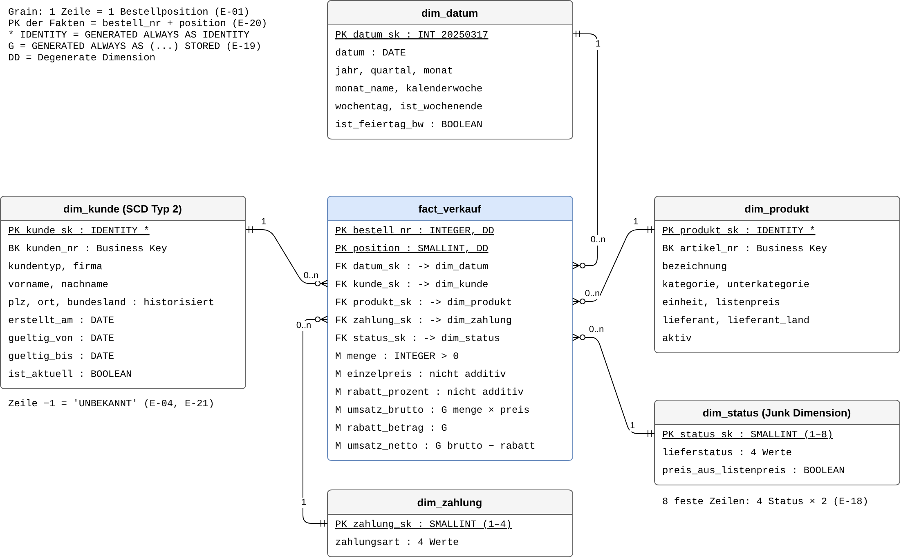

# Projektsteckbrief · DWH Süd-Mineralöl Handel GmbH

Stand: 21.10.2026 · Autor: Daneesh Walika

**Ziel.** Aus uneinheitlichen Exporten des Warenwirtschaftssystems (CSV, JSON) entsteht mit einem Befehl
(`python main.py`) ein geprüftes Data Warehouse im Star Schema auf PostgreSQL 18. Es beantwortet die Fragen
F-01 bis F-08 der Geschäftsleitung nachvollziehbar: Kontrollzahlen je Prüfung, Protokoll der abgewiesenen Zeilen,
gleiches Ergebnis bei jedem Lauf (`docs/anforderungen.md`).

**Leitfrage.** *Womit und wo macht die Süd-Mineralöl ihren Umsatz – nach Monat, Produktkategorie und Region zum
Zeitpunkt der Bestellung?* Beantwortet durch `mart.v_f01_umsatz_monat` (Monat), `mart.v_f03_umsatz_kategorie`
(Kategorie) und `mart.v_f04_umsatz_ort` (Ort und Bundesland zum Bestellzeitpunkt, SCD 2) sowie die Diagramme
D1 und D2 (`docs/diagramme/`). Umsatz = Auftragsumsatz ohne stornierte Positionen (E-13).

**Datenquelle.** Synthetische Daten einer fiktiven Firma, erzeugt mit einem Python-Skript (KI-gestützt) mit
festem Seed (`scripts/generate_data.py`).
Keine URL, kein Teil-Extrakt: Die Dateien werden vollständig geladen und nie verändert (R-02).

| Datei (`data/raw/`) | Inhalt | Zeilen |
|---|---|---|
| `bestellungen.csv` | Bestellpositionen 2024–2025 | 2 181 |
| `kunden.csv` | Kundenstamm | 157 |
| `kunden_update_2026-01.csv` | Änderungen und neue Kunden, Stand 10.01.2026 (E-31) | 20 |
| `produkte.json` | Artikelstamm, verschachtelt | 25 |

- **Datum:** Dateien in `data/raw/` vom 30.09.2026 (Dateisystem); Exportdatum im Inhalt 05.01.2026 (`produkte.json`, Nr 31).
- **Generator-Skript und Seed:** `scripts/generate_data.py`, Seed 42 (`random.seed(42)`, steht im Skript).
  `python scripts/generate_data.py` schreibt die vier Dateien nach `data/generated/` (nicht in Git);
  sie sind byte-gleich mit `data/raw/`. `data/raw/` selbst wird nie überschrieben (R-02).
- **Personenbezug:** Namen, Telefon und E-Mail sind fiktiv. Telefon und E-Mail werden nicht ins DWH geladen (R-03);
  Ergebnisse nennen Kunden nur mit Nummer (E-38).

**Datenmodell.** Eine Faktentabelle `fact_verkauf` (1 Zeile = 1 Bestellposition) mit fünf Dimensionen.
- `dim_kunde`: Adresse als SCD Typ 2 (Historie mit Versionen), damit F-04/F-07 den Wohnort zum Bestellzeitpunkt
  zeigen (E-14, E-31). Die übrigen Attribute sind SCD Typ 1 (überschreiben), weil keine Frage sie zum Bestellzeitpunkt
  braucht (E-32).
- `dim_produkt`: ohne Historie, bei jedem Lauf überschrieben = SCD Typ 1. Keine Frage braucht den Produktstand zum
  Bestellzeitpunkt, und der Verkaufspreis steht als Fakt in `fact_verkauf` (E-33, E-48).

Bild: Export aus `docs/star_schema.drawio`, der einzigen Quelle, Spalte für Spalte gegen `sql/02_create_dwh.sql`
geprüft (E-49):

